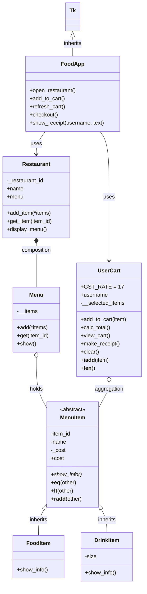

# Food Delivery Platform (Python OOP)

A food ordering system built to practice clean object-oriented design in Python.
Pick a restaurant, browse the menu, fill a cart, and check out with 17% GST applied.

The same classes power **two ways to run it**. Use whichever you like:

| Mode | Command | Best for |
|------|---------|----------|
| Console | `python main.py` | Quick runs, debugging |
| GUI (Tkinter, orange and black theme) | `python gui.py` | Presenting / demo |

## Requirements

- Python 3.8 or newer
- Tkinter (only for the GUI). It ships with Python on Windows and macOS. On Linux: `sudo apt install python3-tk`

No other packages needed.

## Project Structure

```
food_delivery_v2/
├── menu.py         # MenuItem (abstract), FoodItem, DrinkItem, Menu
├── restaurant.py   # Restaurant
├── cart.py         # UserCart
├── main.py         # Console app
├── gui.py          # Tkinter app (FoodApp)
└── README.md
```

## How to Use

**Console:** run `python main.py`, choose a restaurant (1-4), enter your name, then type item ids to add them to the cart. Type any non-numeric key to finish. You get the cart, the total with GST, and a receipt summary.

**GUI:** run `python gui.py`
1. Choose a restaurant and enter your name, then click **Open**.
2. Select an item in the Menu list and click **Add to cart**.
3. Watch the cart and total (incl. 17% GST) update.
4. Click **Checkout** to see the receipt. The cart is then emptied.

## Class Diagram



Legend: `*--` composition (the part dies with the whole), `o--` aggregation (the part exists on its own), `<|--` inheritance, `-->` uses, `*` after a method name means abstract.
GitHub renders this diagram automatically.

## OOP Concepts Used

| Concept | Where |
|---------|-------|
| Classes, objects, `__init__`, `self` | Every class |
| Encapsulation | `cost` property with validation (`menu.py`); private `__items` and `__selected_items`; protected `_restaurant_id` |
| Abstraction | `MenuItem` is an abstract class with abstract `show_info()` |
| Inheritance | `FoodItem` and `DrinkItem` extend `MenuItem`; `FoodApp` extends `tk.Tk` |
| Constructor chaining | `DrinkItem` calls `super().__init__()` |
| Method overriding / polymorphism | Each item type implements `show_info()` differently; the cart just calls it |
| `*args` | `Menu.add(*items)` and `Restaurant.add_item(*items)` |
| Composition | `Restaurant` creates and owns its `Menu` |
| Aggregation | `UserCart` holds items that exist independently in the menu |
| Magic methods | `__lt__` (sort by price), `__eq__`, `__radd__` (`sum(items)`), `__iadd__` (`cart += item`), `__len__` |
| `__slots__` | Menu item classes only allow their declared attributes |
| Deep copy | `UserCart.make_receipt()` uses `copy.deepcopy` for an independent receipt |

## Notes

- Prices are in Rs.; GST is 17% and is set by `UserCart.GST_RATE`.
- The menu is sorted cheapest first (via `__lt__`).
- The console and GUI share `menu.py`, `restaurant.py` and `cart.py`, so a change in those files affects both.
