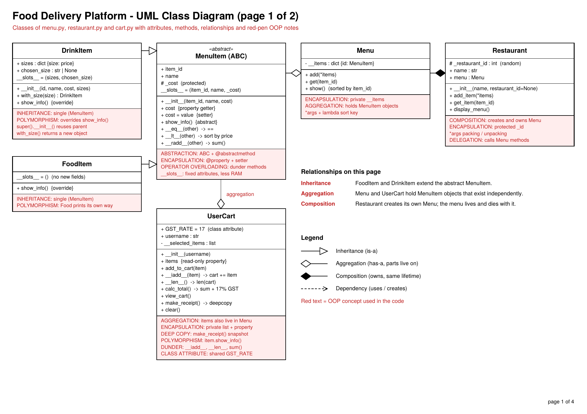
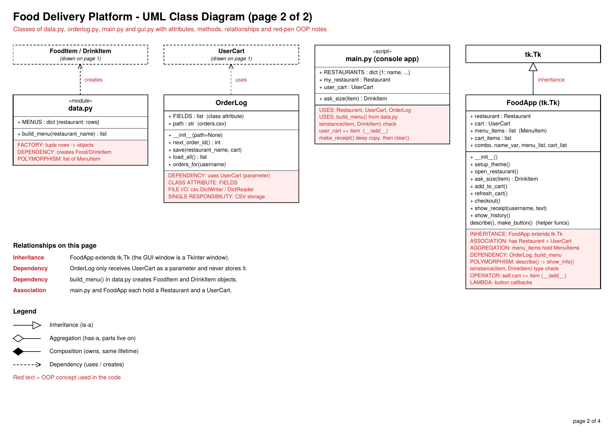
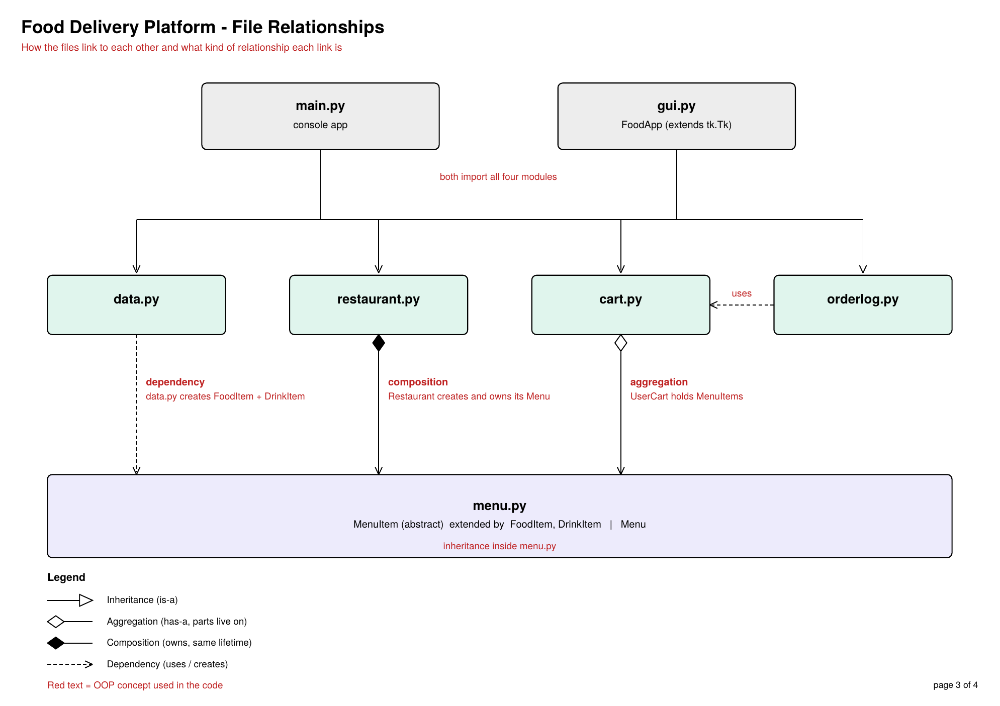

# OOPs Food Delivery Platform

A food ordering system in Python, built to apply core object-oriented programming principles over a real-world workflow: pick a restaurant, browse its menu, build a cart, check out, and keep a history of past orders. It runs as a console app (`main.py`) or as a themed Tkinter GUI (`gui.py`).

## Overview

The project simulates a full ordering session end to end: restaurant selection (8 restaurants, each with its own menu), menu display, item lookup by ID, drink size selection, cart management, 17% GST calculation, receipt generation, and order logging to `orders.csv`. Everything is built with a class-based structure instead of a flat script.

## Structure

| File            | Responsibility                                                                                  |
| --------------- | ----------------------------------------------------------------------------------------------- |
| `main.py`       | Console entry point: drives the ordering flow and user I/O                                      |
| `gui.py`        | Tkinter GUI (`FoodApp`, orange and black theme): menu, cart, checkout, receipt, order history   |
| `menu.py`       | `MenuItem` (abstract), `FoodItem`, `DrinkItem`, and `Menu`                                      |
| `restaurant.py` | `Restaurant` class: owns a `Menu` and delegates item lookup to it                               |
| `cart.py`       | `UserCart` class: selected items, GST total, deep-copied receipt                                |
| `orderlog.py`   | `OrderLog` class: saves and reads orders in `orders.csv`                                        |
| `data.py`       | Menu data for all restaurants and the `build_menu()` factory                                    |
| `orders.csv`    | Order history, one row per item                                                                 |

## UML Class Diagram

Each box lists attributes and methods. The red notes mark the OOP concept used in that class.





## File Relationships

How the files link to each other, and which kind of relationship each link is.



| Link                         | Type        | Why                                                              |
| ---------------------------- | ----------- | ---------------------------------------------------------------- |
| `FoodItem`, `DrinkItem` to `MenuItem` | Inheritance | Both extend the abstract base class                      |
| `Restaurant` to `Menu`       | Composition | The restaurant creates its own menu, so the menu lives and dies with it |
| `Menu` to `MenuItem`         | Aggregation | The menu holds items that are created elsewhere                  |
| `UserCart` to `MenuItem`     | Aggregation | Cart items also exist in the menu                                |
| `OrderLog` to `UserCart`     | Dependency  | Receives the cart as a parameter, never stores it                |
| `data.py` to `FoodItem`, `DrinkItem` | Dependency | `build_menu()` creates the objects                       |
| `FoodApp` to `tk.Tk`         | Inheritance | The GUI window is a Tkinter window                               |

## OOP Concepts Practiced

- **Abstraction:** `MenuItem` is an abstract base class (`ABC`, `@abstractmethod`) and cannot be created directly.
- **Encapsulation:** `@property` with a validating setter for `cost`, a private `__items` dict in `Menu`, a private cart list exposed through a read-only property.
- **Inheritance:** single inheritance from `MenuItem` into `FoodItem` and `DrinkItem`, and `FoodApp` extending `tk.Tk`.
- **Polymorphism:** `show_info()` is overridden, so food and drinks print differently through the same call.
- **Composition and aggregation:** `Restaurant` owns its `Menu`; `Menu` and `UserCart` hold `MenuItem` objects they did not create.
- **Operator overloading:** `__eq__`, `__lt__`, `__radd__` (so `sum(items)` works), `__iadd__` (`cart += item`), `__len__`.
- **Deep copy:** `make_receipt()` returns an independent snapshot of the cart.
- **Class attributes and `__slots__`:** `GST_RATE`, `OrderLog.FIELDS`, and fixed attributes on menu items.
- **Variable arguments:** `*args` packing and unpacking in `add_item()` and `Menu.add()`.

## How It Works

1. User picks one of 8 restaurants.
2. `build_menu()` loads that restaurant's own menu into a `Restaurant` instance.
3. User enters a name to start a cart session.
4. User adds items by ID (or by selection in the GUI). Drinks ask for a cup size first.
5. The cart shows the total including 17% GST.
6. On checkout the order is saved to `orders.csv`, a receipt copy is made, and the cart is cleared.
7. In the GUI, the History button shows a customer's past orders, newest first.

## Run It

Console version:

```
python main.py
```

GUI version:

```
python gui.py
```

## Notes

This is a learning-focused project: no payment integration and no database. Orders persist in a plain CSV file. The goal was structuring a real-world process cleanly with OOP.
